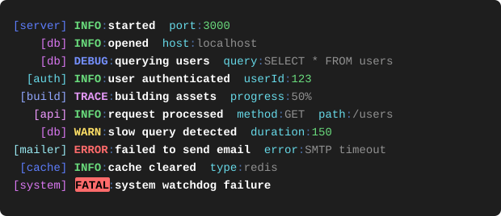

# pino-zen

Colored log formatter for [Pino](https://getpino.io) JSON logs. Works as a **Pino transport** or a **CLI pipe**.



## Install

Requires Node.js 22 or later.

```sh
npm install pino-zen        # project dependency (transport)
npm install -g pino-zen     # global CLI
```

## Pino Transport

```js
import pino from "pino"

const logger = pino({
  transport: { target: "pino-zen" },
})
```

pino-zen is meant for reading logs in a terminal. In production, keep writing JSON and add pino-zen as a second target, or pipe through the CLI when you need to read the logs:

```js
const logger = pino({
  transport: {
    targets: [
      { target: "pino/file", options: { destination: "app.log" } },
      { target: "pino-zen" },
    ],
  },
})
```

## CLI

Pipe Pino NDJSON output through the CLI:

```sh
node app.js | pino-zen
node app.js | npx pino-zen -m name
```

Lines that are not JSON objects are printed unchanged. When reading from a pipe, Ctrl+C is ignored so the upstream process can exit first and its final log lines still get formatted.

## Options

| Option | CLI flag | Description |
|--------|----------|-------------|
| `module` | `-m, --module <field>` | Show this field as a color-coded `[module]` prefix |
| `formatter` | — | Fields to hide, e.g. `{ pid: false, hostname: false }`. Matching keys are hidden at every nesting level |
| `destination` | — | File path or file descriptor to write to. Default: `1` (stdout) |
| — | `-h, --help` | Show usage |
| — | `-v, --version` | Show the version |

Transport options go in `options`:

```js
const logger = pino({
  transport: {
    target: "pino-zen",
    options: { module: "name", formatter: { pid: false, hostname: false } },
  },
})

logger.info({ name: "api" }, "request processed")
logger.info({ name: "auth" }, "user verified")
```

```text
[api]  INFO:request processed
[auth]  INFO:user verified
```

Each module name gets its own color, and the prefix is right-aligned to the longest name seen so far.

## Output

- `time` is never shown. `msg` follows the level; other fields are shown as `key:value`, with objects as `key:{ ... }` and arrays as `key:[ ... ]`.
- Error stacks (e.g. pino's `err`) are printed on the lines below the entry.
- Colors follow [chalk](https://github.com/chalk/chalk#supportscolor) detection. Set `NO_COLOR=1` to disable them, or `FORCE_COLOR=1` to force them (e.g. when writing to a file).

## Programmatic Use

```js
import { FormatMessage } from "pino-zen"

console.log(FormatMessage({ level: 30, msg: "hello", port: 3000 }, {}))
```

## License

MIT
